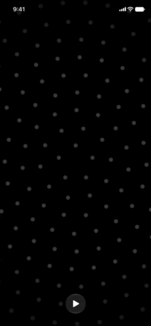
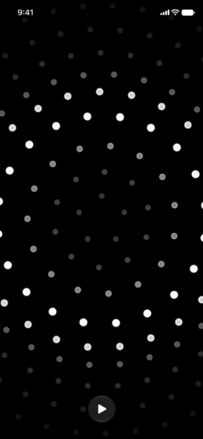
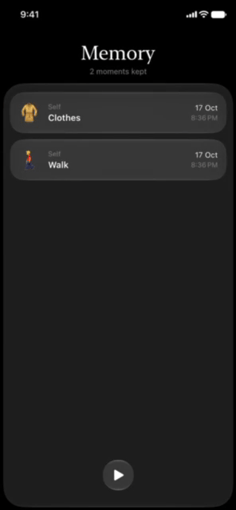
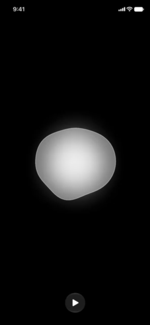
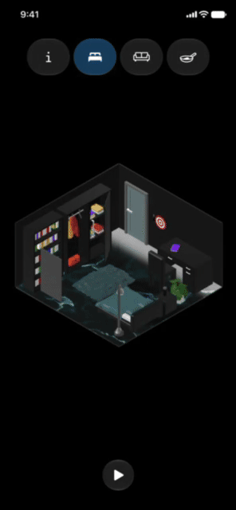
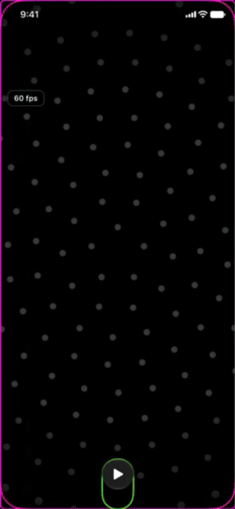

  &nbsp;&nbsp;&nbsp;&nbsp;
  

# Lumen for iOS
### Developed by s4tturn.
**Small things matter. Lumen helps you turn those small acts of care into visible progress.**

Lumen is a wellbeing app built around a simple idea: when life feels overwhelming, you do not always need to fix everything. Sometimes it helps to start with one small thing.

Lumen gives you simple, concrete things to do across six collections: **Self · Space · Kitchen · Connection · Growth · Joy**. Every completed task adds something to a 3D room. Furniture, objects, and decorations gradually appear as you do more, turning the room into a quiet record of the things you've actually done.
**Do something. See it become real.**

## The idea behind Lumen

Lumen started not as a classic motivational quotes app or a schedule planner, or around doing more for the sake of doing more. It started from the idea of making small efforts easier, and gaining momentum from those small moments to focus on the big things in life.
**Sometimes one small thing is enough to get moving again. Lumen helps you start there.**

## The basic app
Lumen is built as one continuous space rather than a collection of tabs. Home is the centre, while all other pages surround it on all 4 sides.

|                 | Experiences                                                  |
| --------------- | ------------------------------------------------------------ |
| **Memory**      | A visual history of what you've completed.                   |
| **Home**        | A calm, ambient space of light and motion.                   |
| **Breathe**     | A tactile breathing experience with a responsive fluid form. |
| **Collections** | Six collections of small, meaningful actions.                |
| **Room**        | A 3D space that grows with your progress.                    |

## Home

From Home, you move between pages by swiping in different directions. Home itself is a gorgeous and mesmerising dot matrix that aims to lock our racing minds and install a sense of peace and purpose. Navigation is meant to feel more like moving through a place than moving through menus, using gorgeous and inertial movement that feels tactile, fluid and powerful.

## Ambient System

Ambient system is an elegant and tiny ambiance player that is there when you need, and subtle when you don't. It is configured to contain Rain, Wind and Forest sounds, with a unique and innovative take on conventional players. When paused, the player is a tiny bubble that seems out of the way. When playing, its just visible enough to indicate the basics and still be undistracting. Hold and drag up on the player to select an ambiance source, hold and drag horizontally to manage volume, and let go to set that state. Tap on the player to play/pause.

## Collections System
Collections is a gorgeous turntable that rotates on drag, with cards above that rotate with the movement of the turntable. Rotate the turntable to focus on the desired collection, and click on the card to go fullscreen and browse and complete its respective tasks.

## Memory

Memory is a gorgeous log of every accomplishment you've made. Scroll through all the tasks you've accomplished, and when you accomplished them.

## Breathe

Breathe is a stunning mathematical blob that reacts to touch and helps calm you down. Long press to arm it and eliminate all other distractions, and follow along as it breathes with you, following a 4-7-8 breathing cycle until you hold down and disarm it.

## Rooms System

Room is a meticulously designed series of Bedroom, Living Room and Kitchen 3d rooms, each of which slowly fill with every task accomplished. Many models are made by app developer s4tturn, and outsourced models are credited in the app and at /Lumen/Views/Systems/Room/Credits/CREDITS.md.

## Keychain Storage System
To bypass the need for a paid developer account or signing in, Lumen uses keychain storage to store all completed tasks. No login, no hassle. Synced via iCloud without needing to use CloudKit.

## Debug Build

The Lumen app also has a debug variant that is built the same way, from the same source code, but with a different id, icon and seperated keychain so debugging doesn't affect release builds. Debug views include visual borders for touch targets and elements, and an fps counter.

## Made for Apple platforms
Lumen is designed from the ground up for iPhone and iPad, with close attention to Apple's Human Interface Guidelines and native platform conventions. Accessibility, Dynamic Type, Reduce Motion, haptics, gestures, and spatial layout are considered as part of the experience rather than added afterwards.
Liquid Glass is a natural part of the visual language, used alongside motion, depth, typography, and materials to create an interface that feels light and responsive without getting in the way.

## Small, tactile interactions
The interface is meant to respond to you. Press and hold the form in Breathe and it reacts to your touch before settling into a breathing rhythm. Turn the Room and the space moves with you. Haptics along each ridge of the turntable and in navigation make every movement feel intentional and responsive.
Motion throughout the app follows the same restrained feel: fluid when it should be, quiet when it should be, and never there just for decoration.

